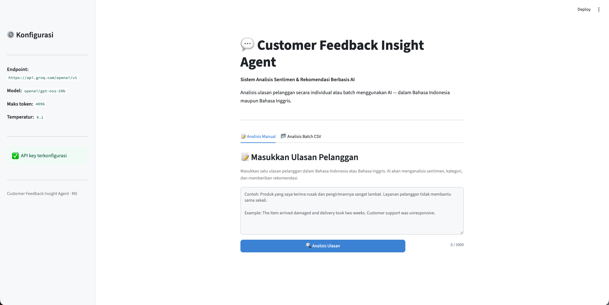
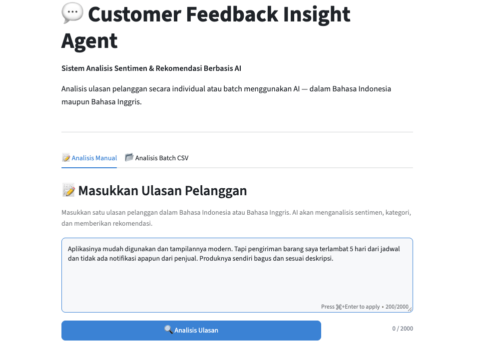
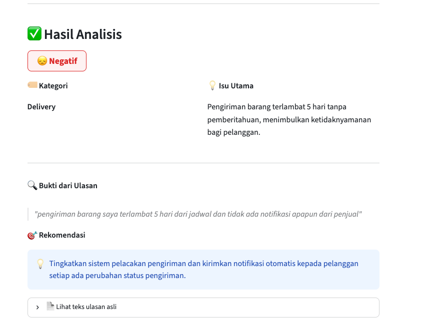
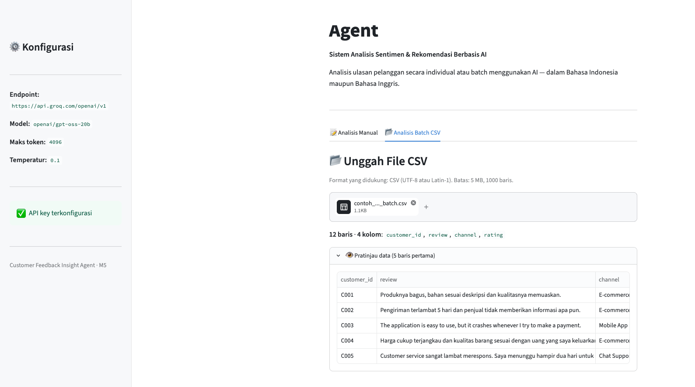
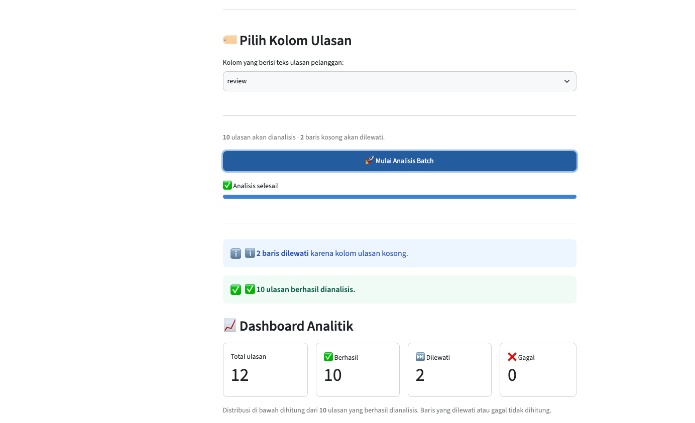
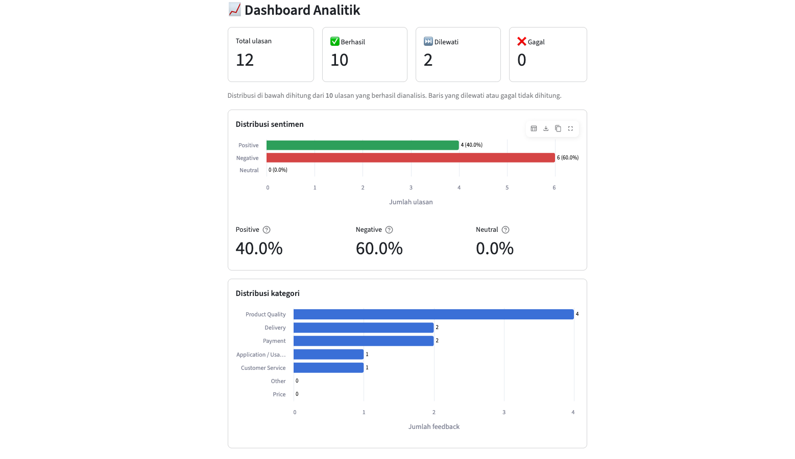
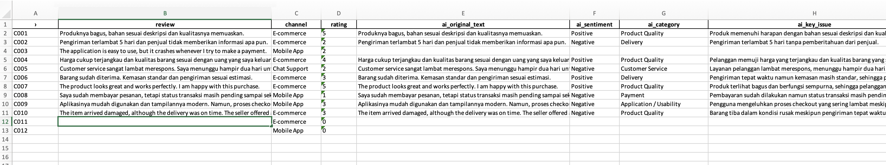
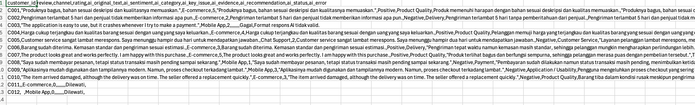

# Customer Feedback Insight Agent

**AI-powered sentiment analysis and recommendation system for customer feedback (Indonesian & English).**

---

## Table of Contents

1. [Project Overview](#project-overview)
2. [Problem Background](#problem-background)
3. [Key Features](#key-features)
4. [Technology Stack](#technology-stack)
5. [System Architecture](#system-architecture)
6. [Project Structure](#project-structure)
7. [Installation Guide](#installation-guide)
8. [Environment Configuration](#environment-configuration)
9. [How to Run](#how-to-run)
10. [How to Run Tests](#how-to-run-tests)
11. [Usage Guide](#usage-guide)
12. [Screenshots](#screenshots)
13. [Limitations](#limitations)
14. [Future Development](#future-development)
15. [Author](#author)

---

## Project Overview

Customer Feedback Insight Agent is a Streamlit web application that uses a Large
Language Model (LLM) to turn raw customer reviews into structured, actionable
insights. For every review the system returns exactly six fields:

| Field | Description |
|---|---|
| `original_text` | The review, echoed back verbatim (verified by the app) |
| `sentiment` | `Positive`, `Negative`, or `Neutral` |
| `category` | `Product Quality`, `Price`, `Delivery`, `Customer Service`, `Payment`, `Application / Usability`, or `Other` |
| `key_issue` | A concise explanation of the main point of the feedback (in Bahasa Indonesia) |
| `evidence` | A direct quotation from the review that supports the analysis |
| `recommendation` | An actionable suggestion for the business (in Bahasa Indonesia) |

Reviews can be analysed one at a time or in bulk from a CSV file. Batch results
are summarised in an analytics dashboard and can be exported to CSV or Excel.

The LLM's output is validated by the application before it is accepted: the
response must match a strict JSON schema, `original_text` must be identical to
the input, and `evidence` must be an exact substring of the review. This guards
against altered input and fabricated quotations.

---

## Problem Background

Businesses, especially e-commerce sellers, receive large volumes of reviews
through marketplaces, apps, and support channels. Reading and classifying these
manually is slow, inconsistent between reviewers, and hard to scale. Simple
star ratings do not explain *why* a customer is unhappy, and keyword-based
sentiment tools struggle with informal Indonesian, mixed languages, and reviews
that mention several topics at once.

This project explores how an LLM can help by:

- classifying sentiment and topic consistently,
- explaining the main issue in plain language,
- grounding each conclusion in a quotation from the review, and
- suggesting a concrete follow-up action,

while keeping the output structured enough to aggregate into a dashboard.

---

## Key Features

- **Manual feedback analysis**: analyse a single review typed into the app (up to 2,000 characters).
- **Indonesian and English review analysis**: both languages are accepted as input.
- **Sentiment classification**: Positive / Negative / Neutral.
- **Feedback category classification**: seven predefined categories.
- **Key issue identification**: a short summary of the main point.
- **Evidence extraction**: a verbatim quotation from the review, validated as a substring.
- **Actionable recommendation**: a suggested business action.
- **CSV batch processing**: upload a CSV, choose the review column, and analyse every row with a live progress bar. Blank rows are skipped; a failed row never stops the batch.
- **Analytics dashboard**: totals (all / succeeded / skipped / failed), sentiment distribution with percentages, and category distribution. Only successfully analysed rows are counted in the distributions. Results can be filtered by sentiment and category.
- **CSV and Excel export**: download all original columns plus the AI result columns, including skipped and failed rows. CSV uses UTF-8 with BOM (`utf-8-sig`) so Excel displays Indonesian text correctly; Excel files use a sheet named `Hasil Analisis`.

Additional behaviour:

- Results are kept in the Streamlit session, so viewing the dashboard, changing filters, or downloading files does **not** call the AI again.
- Transient API errors (timeouts, rate limits, 5xx) are retried with exponential backoff.
- Error messages in the UI are written in Bahasa Indonesia and explain what the user can do next.

---

## Technology Stack

Taken from `requirements.txt` and the source code:

| Purpose | Technology |
|---|---|
| Language | Python (tested with 3.9.6 and 3.15.2) |
| Web UI | [Streamlit](https://streamlit.io) ≥ 1.50 |
| Charts | [Vega-Altair](https://altair-viz.github.io) |
| Data processing | [pandas](https://pandas.pydata.org) |
| Excel export | [openpyxl](https://openpyxl.readthedocs.io) |
| LLM client | [openai](https://github.com/openai/openai-python) Python SDK (OpenAI-compatible API) |
| LLM provider (default) | [Groq](https://console.groq.com), model `openai/gpt-oss-20b` |
| Output validation | [Pydantic v2](https://docs.pydantic.dev) |
| Configuration | [pydantic-settings](https://docs.pydantic.dev/latest/concepts/pydantic_settings/) + [python-dotenv](https://pypi.org/project/python-dotenv/) |
| Testing | [pytest](https://pytest.org), `unittest.mock`, Streamlit `AppTest` |

---

## System Architecture

The code is organised into four layers. Each layer only depends on the layers
below it, and the OpenAI SDK is imported **only** inside the `llm/` package.

```
┌──────────────────────────────────────────────────────────────┐
│ Presentation   app.py · ui/manual_input.py                   │
│                ui/batch_input.py · ui/analytics.py           │
├──────────────────────────────────────────────────────────────┤
│ Business logic core/analyzer.py · core/batch_analyzer.py     │
│                core/analytics.py · core/exporter.py          │
├──────────────────────────────────────────────────────────────┤
│ AI integration llm/service.py · llm/client.py                │
│                llm/prompts.py · llm/schemas.py               │
├──────────────────────────────────────────────────────────────┤
│ Configuration  config/settings.py ← .env                     │
└──────────────────────────────────────────────────────────────┘
```

| Layer | Module | Responsibility |
|---|---|---|
| Presentation | `app.py` | Page setup, sidebar, API-key guard, tabs |
| | `ui/manual_input.py` | Single-review form, result card, error messages, session cache |
| | `ui/batch_input.py` | CSV upload, preview, column selection, batch run with progress, status summary |
| | `ui/analytics.py` | Dashboard metrics and charts, result filters, download buttons |
| Business logic | `core/analyzer.py` | `analyze_feedback()`, the single entry point for analysing one review |
| | `core/batch_analyzer.py` | CSV loading/validation, sequential batch runner, merging results into a DataFrame |
| | `core/analytics.py` | Pure functions for status counts, sentiment/category distributions, filtering |
| | `core/exporter.py` | DataFrame → CSV bytes (`utf-8-sig`) and Excel bytes (openpyxl) |
| AI integration | `llm/prompts.py` | System prompt and user prompt template |
| | `llm/schemas.py` | `FeedbackAnalysis` model, enums, JSON schema for structured output |
| | `llm/client.py` | Builds the OpenAI-compatible client from settings |
| | `llm/service.py` | API call, JSON parsing, validation, retries, error mapping |
| Configuration | `config/settings.py` | Loads and validates environment variables |

### Analysis flow

```
UI ──► core.analyzer.analyze_feedback(text)
          └─► llm.service.analyse_feedback(text)
                 ├─ prompts + JSON schema
                 ├─ client.chat.completions.create(...)   ← Groq API
                 ├─ retry on transient errors (backoff)
                 └─ parse JSON → verify original_text → FeedbackAnalysis.model_validate()
```

Batch mode calls the same function once per non-blank row
(`core.batch_analyzer.run_batch`). `results_to_dataframe()` then merges the
results with the original CSV columns. The dashboard and the exporters read only
that DataFrame from the session state.

### Error handling

| Exception | Cause | Retried? |
|---|---|---|
| `TransientError` | Timeout, connection error, rate limit (429), 5xx | Yes, up to `LLM_MAX_RETRIES` |
| `AuthenticationError` | Missing/invalid API key (401/403) | No |
| `InvalidRequestError` | Unknown model or invalid parameters (400) | No |
| `ResponseParseError` | Empty/non-JSON response, schema mismatch, altered text, truncated output | No |

In batch mode each failure is recorded on its row (`ai_status = Gagal`, reason
in `ai_error`) and processing continues with the next row.

---

## Project Structure

```
Customer Feedback Insight Agent/
├── app.py                     # Streamlit entry point
├── requirements.txt           # Python dependencies
├── .env.example               # Configuration template (copy to .env)
├── .gitignore
├── pyrightconfig.json         # Type-checker configuration
├── README.md
├── .streamlit/
│   └── config.toml            # Streamlit theme
├── config/
│   ├── __init__.py
│   └── settings.py            # Environment-variable settings (pydantic-settings)
├── core/
│   ├── __init__.py
│   ├── analyzer.py            # Single-review business entry point
│   ├── batch_analyzer.py      # CSV loading and batch processing
│   ├── analytics.py           # Dashboard statistics and filters
│   └── exporter.py            # CSV / Excel export
├── llm/
│   ├── __init__.py
│   ├── client.py              # OpenAI-compatible client factory
│   ├── prompts.py             # System and user prompts
│   ├── schemas.py             # Output schema and enums
│   └── service.py             # API call, validation, retry logic
├── ui/
│   ├── __init__.py
│   ├── manual_input.py        # Manual analysis tab
│   ├── batch_input.py         # Batch CSV tab
│   └── analytics.py           # Dashboard, filters, downloads
├── data/
│   └── sample_feedback.csv    # 12 sample reviews (synthetic) for trying the app
├── scripts/
│   └── test_llm.py            # Manual end-to-end check against the real API
└── tests/
    ├── __init__.py
    ├── test_settings.py       # Configuration validation
    ├── test_schemas.py        # Output schema and validators
    ├── test_service.py        # LLM service with a mocked client
    ├── test_analyzer.py       # Business entry point
    ├── test_manual_input.py   # Manual-analysis session caching and errors
    ├── test_batch_analyzer.py # CSV validation, batch processing, result merging
    └── test_analytics_export.py # Dashboard stats, filters, CSV/Excel export, UI flows
```

---

## Installation Guide

### Prerequisites

- Python 3.9 or later (`python3 --version`)
- Internet access (to install packages and to reach the LLM API)
- A Groq API key (free tier available, see [Environment Configuration](#environment-configuration))

### Steps (macOS / Linux)

```bash
# 1. Go to the project folder
cd "Customer Feedback Insight Agent"

# 2. Create and activate a virtual environment
python3 -m venv .venv
source .venv/bin/activate

# 3. Install dependencies
python -m pip install --upgrade pip
python -m pip install -r requirements.txt

# 4. Create your configuration file
cp .env.example .env
```

On Windows, activate the environment with `.venv\Scripts\activate` and copy the
file with `copy .env.example .env`.

---

## Environment Configuration

All settings are read from a `.env` file in the project root. Start from the
template:

```bash
cp .env.example .env
```

Then open `.env` and replace the placeholder with your own key:

```
LLM_API_KEY=your_api_key_here
```

**Getting a Groq API key**

1. Sign in at [console.groq.com](https://console.groq.com).
2. Open **API Keys** and create a new key.
3. Copy it into `LLM_API_KEY` in your `.env` file.

> `.env` is listed in `.gitignore`. Never commit it or paste your key into code,
> issues, or screenshots. The app never prints the key; the sidebar only shows
> whether one is configured.

### Variables

| Variable | Default | Description |
|---|---|---|
| `LLM_API_KEY` | *(empty)* | API key for the provider. Required. |
| `LLM_BASE_URL` | `https://api.groq.com/openai/v1` | OpenAI-compatible endpoint |
| `LLM_MODEL` | `openai/gpt-oss-20b` | Model identifier |
| `LLM_MAX_TOKENS` | `4096` | Maximum tokens per response (64–32768) |
| `LLM_TEMPERATURE` | `0.1` | Sampling temperature (0.0–1.0) |
| `LLM_TIMEOUT_SECONDS` | `30` | Per-request timeout (5–120) |
| `LLM_MAX_RETRIES` | `3` | Retries for transient errors (0–10) |
| `BATCH_SIZE` | `5` | Number of API calls before a pause in batch mode (1–50) |
| `BATCH_DELAY_SECONDS` | `1` | Length of that pause in seconds (0–30) |
| `MAX_CSV_SIZE_MB` | `5` | Maximum CSV upload size (1–50) |
| `MAX_CSV_ROWS` | `1000` | Maximum rows per CSV (1–10000) |

Invalid values (for example a non-numeric timeout, an out-of-range number, or
a malformed URL) are rejected at start-up by Pydantic validation, and the error
names the offending variable.

---

## How to Run

With the virtual environment activated:

```bash
streamlit run app.py
```

Streamlit opens the app at <http://localhost:8501>. If no API key is
configured, the app shows a setup message instead of the analysis tabs.

To check the API connection from the terminal (sends **one** real request):

```bash
python scripts/test_llm.py
```

---

## How to Run Tests

The automated tests run offline: every LLM call is mocked, so no API key or
internet connection is needed.

```bash
python -m pytest -q
```

Current result on the main development environment (Python 3.15.2,
Streamlit 1.67.0) and on a fresh Python 3.9.6 environment installed from
`requirements.txt`:

```
232 passed
```

| Test file | Tests | Area |
|---|---|---|
| `test_settings.py` | 31 | Configuration loading and validation |
| `test_schemas.py` | 41 | Output schema, enums, evidence validator |
| `test_service.py` | 50 | API call, parsing, retries, error mapping (mocked client) |
| `test_analyzer.py` | 15 | Business entry point |
| `test_manual_input.py` | 20 | Manual-analysis caching and error states |
| `test_batch_analyzer.py` | 50 | CSV validation, batch processing, result merging |
| `test_analytics_export.py` | 25 | Dashboard statistics, filters, CSV/Excel export, UI flows without AI calls |

---

## Usage Guide

### 1. Manual analysis

1. Open the **📝 Analisis Manual** tab.
2. Type or paste one review (Indonesian or English, max 2,000 characters).
3. Click **🔍 Analisis Ulasan**.
4. The result card shows the sentiment, category, key issue, evidence quote,
   and recommendation. Submitting the same text again reuses the stored result
   instead of calling the API.

### 2. Batch CSV analysis

1. Open the **📂 Analisis Batch CSV** tab.
2. Upload a CSV file (UTF-8 or Latin-1, header row required). You can try
   `data/sample_feedback.csv`.
3. Check the preview and select the column that contains the review text
   (a column named like `review`, `ulasan`, `feedback`, … is pre-selected).
4. Click **🚀 Mulai Analisis Batch** and wait for the progress bar to finish.
5. A status message reports how many rows succeeded, were skipped (blank), or
   failed.

### 3. Dashboard

After a batch run, the **📈 Dashboard Analitik** section shows:

- totals for all, succeeded, skipped, and failed rows,
- a sentiment chart with counts and percentages,
- a category chart covering all seven categories.

Percentages are calculated from successfully analysed rows only. If no row
succeeded, an information message is shown instead of empty charts. Uploading
a new CSV clears the previous results; the dashboard updates after the next run.

The **📋 Tabel Hasil Analisis** table can be filtered by sentiment and
category. Filters change only the table, not the dashboard or the exported
files. Failed and skipped rows are visible when no filter is selected; the
reason for a failure is in the `ai_error` column.

### 4. Export

In **💾 Unduh Hasil Analisis**:

- **Unduh CSV**: `hasil_analisis_<date>_<time>.csv`, UTF-8 with BOM.
- **Unduh Excel (.xlsx)**: `hasil_analisis_<date>_<time>.xlsx`, sheet `Hasil Analisis`.

Both files contain every original column plus `ai_original_text`,
`ai_sentiment`, `ai_category`, `ai_key_issue`, `ai_evidence`,
`ai_recommendation`, `ai_status`, and `ai_error`, for all rows. Files are
generated in memory from the stored results; nothing is written to the server's
disk and the AI is not called again.

---

## Screenshots

### 1. Main page


### 2. Manual feedback input


### 3. Manual analysis result


### 4. CSV upload and preview


### 5. Batch processing result


### 6. Analytics dashboard


### 7. Exported files



---|---|---|
| 1 | Main page | `docs/screenshots/01-home.png` |
| 2 | Manual feedback input | `docs/screenshots/02-manual-input.png` |
| 3 | Manual analysis result | `docs/screenshots/03-manual-result.png` |
| 4 | CSV upload and preview | `docs/screenshots/04-csv-preview.png` |
| 5 | Batch processing result | `docs/screenshots/05-batch-result.png` |
| 6 | Analytics dashboard | `docs/screenshots/06-dashboard.png` |
| 7 | Exported CSV and Excel files | `docs/screenshots/07-export_CSV.png`, `docs/screenshots/07-export_Excel.png` |

---

## Limitations

- **Requires an internet connection and a third-party LLM API.** Analysis is
  unavailable when the provider is down, the key is invalid, or the rate limit
  is reached. Free-tier rate limits may slow down or fail large batches.
- **Review text is sent to the LLM provider.** Do not upload data you are not
  allowed to share with the provider.
- **AI output can vary.** The same review may receive a different category,
  wording, or occasionally a different sentiment on separate runs. Results
  should support, not replace, human judgement. No formal accuracy evaluation
  has been carried out.
- **Strict validation can reject responses.** If the model changes the review
  text or quotes evidence that is not an exact substring, the row is marked
  as failed. Running the analysis again usually succeeds.
- **Batch processing is sequential.** Rows are processed one at a time with
  pauses to respect rate limits, so large files take time.
- **Upload limits.** By default 5 MB and 1,000 rows per CSV (configurable up
  to 50 MB / 10,000 rows). Manual input is limited to 2,000 characters.
- **No persistence.** Results live only in the browser session and are lost on
  refresh or when the session ends; download them to keep them.
- **Single-user, local app.** There is no authentication or user management.
- **Fixed taxonomy.** Sentiment and category labels are predefined; each
  review receives one dominant sentiment and one category.
- **Tested provider.** Only Groq with `openai/gpt-oss-20b` has been used during
  development. Other OpenAI-compatible endpoints may require a model that
  supports JSON-schema structured output and the `reasoning_effort` parameter.

---

## Future Development

Not yet implemented:

- Re-run only the failed rows of a batch.
- Parallel or asynchronous batch processing within provider rate limits.
- Trend analysis over time using a date column (e.g. sentiment per week).
- Evaluation against a labelled dataset to measure classification quality.
- Customisable category lists.
- Optional persistent storage of analysis history.
- User authentication for multi-user deployment.
- Downloadable summary report (e.g. PDF) of the dashboard.

---

## Author

| | |
|---|---|
| Name | *Aldi Saputra* |
| Student ID | *220401010209* |
| Institution | *Universitas Siber Asia* |
| Contact | *aldiisptraaaa@gmail.com* |
| GitHub | *https://github.com/aldisaputra3* |

This project was developed as a student capstone project.
